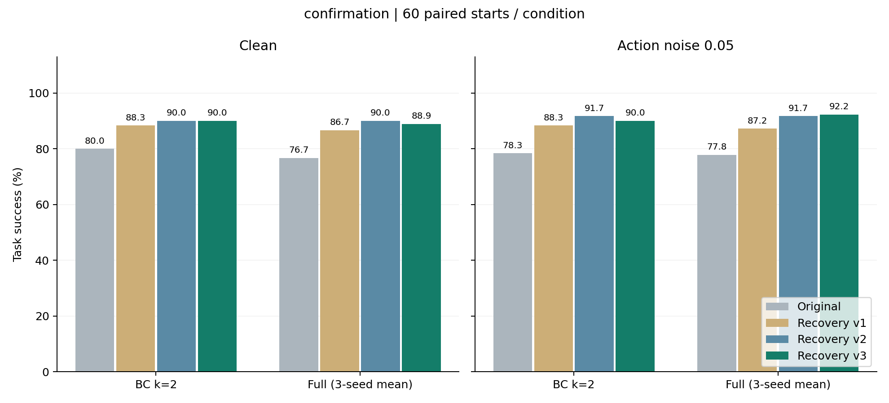

# v3 对齐与箱格碰撞改进：实验报告

生成时间：2026-10-12T06:03:41.583882+00:00。本报告是工程实验记录，不是论文。

## 结论与保存状态

本轮完成三轮开发对照、冻结后的 1920 回合原生起点独立确认，以及 32 回合独立几何压力测试。v3 在本批原生确认中为 434/480，v2 为 436/480；较 v2 救回 1 回合，新增失败 3 回合。每个版本的 480 是执行回合数，仅来自 60 个共享起点，不能当作 480 个独立样本。

本轮所有改动在 `reproduction/recovery_v3_20261012_01/`。检查前存在的 2263 个项目文件 SHA-256 均不变，包含 v1、v2、现有权重及结果。没有重新训练、替换或删除权重，没有更改根目录控制代码，没有撰写论文。

## 修改与诊断

- 对齐：等价抓取 yaw 使用固定中性扇区，避免只按末端最短转角选择导致腕部顶限位；时限按当前位置/姿态误差设置为 70–110 步；只在高处对齐时允许平移增量范数达到 0.05 m（原环境动作界限内）。
- 直立角落：同时考虑两面墙的间隙，选择斜向夹爪朝向、约 0.060 m 预开口及每轴 0.006 m 内侧偏置。
- 侧倒靠墙：根据已知掌部跨度与箱格几何，使掌部向格内倾斜，最大 35°，降低掌部撞墙造成的下降超时。
- 共享控制器仍只读 23 维状态历史和固定任务几何；关节限位和真实接触只用于事后诊断。BC 与 Full 使用完全相同的恢复逻辑。D=2 队列不清空、400 步预算、两次恢复上限、原权重与原 Full 评分保持不变。
- 同一已知开发状态的分支诊断：旧 yaw 在 110 步后仍约 6.89 cm / 0.305 rad 偏差；等价 yaw=0 在第 85 步满足对齐条件。这是机制证据，不是新的独立成功回合。
- 角落两例初版接触计数从 116/115 降至 0/0；最终较快对齐版相应为 2/0，并完成任务。只在控制边界采样接触，不能声称整个物理轨迹绝对无碰撞。

详细开发记录与未通过的版本见 [DEVELOPMENT_NOTES.md](DEVELOPMENT_NOTES.md)、各 `pilot_*` 和 `dev_*` 目录。

## 开发集与冻结

| 版本 | 成功 / 240 | 相对 v2 的救回 / 新增失败 | 是否通过预登记门槛 |
|---|---:|---:|---|
| dev_a | 231 | 2 / 0 | 未通过 |
| dev_b | 231 | 2 / 0 | 未通过 |
| dev_c | 233 | 4 / 0 | 通过 |

门槛在首次 v3 运行前登记：总成功至少 232/240；相对 v2 新增失败不超过 2；BC clean/noise 均至少 28/30；Full clean 至少 84/90、noise 至少 89/90。反复使用开发集会产生选择偏差，因此开发成绩不作为最终泛化证据。

最终冻结后才生成 60 个新原生起点（seeds 626101201–626101260，demo_6000000–6000059）。与 320 个既有原生/数据初始状态无重复；逆序重新生成状态完全一致；保存的 XML 重新载入观测误差小于 1e-5。所有起点保留，没有按结果筛选。噪声由 70000+demo 编号固定生成。

## 全新原生起点确认

| 条件 | 方法 | 无恢复 | v1 | v2 | v3 |
|---|---|---:|---:|---:|---:|
| 无噪声 | BC k=2 | 48/60 | 53/60 | 54/60 | 54/60 |
| 无噪声 | Full s17 | 45/60 | 50/60 | 52/60 | 51/60 |
| 无噪声 | Full s23 | 47/60 | 53/60 | 55/60 | 54/60 |
| 无噪声 | Full s41 | 46/60 | 53/60 | 55/60 | 55/60 |
| 噪声 0.05 | BC k=2 | 47/60 | 53/60 | 55/60 | 54/60 |
| 噪声 0.05 | Full s17 | 46/60 | 51/60 | 54/60 | 55/60 |
| 噪声 0.05 | Full s23 | 47/60 | 53/60 | 55/60 | 55/60 |
| 噪声 0.05 | Full s41 | 47/60 | 53/60 | 56/60 | 56/60 |

| 版本 | 合计执行成功 / 480 |
|---|---:|
| 无恢复 | 373/480 |
| v1 | 419/480 |
| v2 | 436/480 |
| v3 | 434/480 |

## 配对统计与解释

以 60 个起点为重采样单位，Full 的三个固定训练种子先在每个起点内平均；20000 次配对 bootstrap，随机种子 20261014。以下区间为描述性 95% bootstrap 区间，未做多重比较修正，也不包含训练种子总体不确定性。

| 条件 | 比较 | 成功率差（百分点） | 95% 区间 |
|---|---|---:|---:|
| 无噪声 | BC: v3 − v2 | +0.00 | [+0.00, +0.00] |
| 无噪声 | Full: v3 − v2 | -1.11 | [-2.78, +0.00] |
| 无噪声 | v3: Full − BC | -1.11 | [-6.11, +3.33] |
| 噪声 0.05 | BC: v3 − v2 | -1.67 | [-5.00, +0.00] |
| 噪声 0.05 | Full: v3 − v2 | +0.56 | [+0.00, +1.67] |
| 噪声 0.05 | v3: Full − BC | +2.22 | [-2.22, +7.22] |

Full 与 BC 的差异必须看上表及区间，不能因为总成功率较高就声称世界模型稳定胜出。恢复改进是共享的手工反馈控制改进，没有改善或再训练世界模型权重。

## 独立几何压力测试

另用 16 个新原生 reset 种子和独立姿态随机源生成起点，v2/v3 同样在第 80 步强制进入恢复，基础提议固定为静止张爪。这用于隔离恢复机构的能力，不是自然 BC/Full 策略的成功率，不计入上面的 480 回合。

| 初始几何 | v2 | v3 | 救回 / 新增失败 |
|---|---:|---:|---:|
| source_far_alignment | 4/4 | 4/4 | 0 / 0 |
| destination_corner | 0/4 | 1/4 | 1 / 0 |
| sideways_source | 3/4 | 3/4 | 0 / 0 |
| sideways_destination | 1/4 | 2/4 | 1 / 0 |

## 剩余问题与干预代价

原生确认仍有 46 个失败执行回合，事后分类：`{'retries_exhausted': 33, 'budget_incomplete': 6, 'outside_workspace': 7}`。逐例位置、事件、救回和退步清单在 `diagnosis_confirmation.json`。不要将跨策略、跨噪声或跨训练种子的同一起点重复失败当作独立环境样本。

| 控制版本 | ALIGN 阶段超时事件 | DESCEND 阶段超时事件 | 发生干预的回合 | 检测到失抓后成功 / 触发回合 | 含失败的平均步数 |
|---|---:|---:|---:|---:|---:|
| v1 | 4 | 7 | 83 | 27/32 | 171.10 |
| v2 | 28 | 14 | 124 | 26/31 | 171.04 |
| v3 | 23 | 14 | 124 | 26/30 | 171.56 |

阶段超时是事件数，一回合可能有两次；失抓触发集合随控制器改变，并非相同样本上的配对成功率。并行运行的决策耗时不能当作严格的实时性能比较。

v3 仍没有在线避障规划、关节可达性求解、物体落出工作区后的重置机制或视觉估计鲁棒性。固定中性 yaw 和几何近似只是有限场景下的工程规则；不能保证任意角落、任意倒伏姿态都能恢复。进一步工作应先按失败事件区分接近路径、壁面间隙和剩余时间预算，再在新开发夹具上设计最小改动，不能继续在本批确认集上调参后仍称其为独立测试。

## 完整度与本科毕设适用性

本轮已形成可审查的闭环：原因诊断 → 保留失败的原型 → 预登记开发门槛 → 通过门槛后冻结 → 全新起点的公平对照 → 配对不确定性分析 → 全轨迹验证和剩余故障记录。它可作为本科毕业设计的实验与工程部分，建议定位为“基于世界模型候选决策与状态反馈恢复的机器人搬运系统”。学校没有提供正式任务书或评分细则，因此这不是对毕业合格的保证。

现有证据支持有边界的工程改进与系统实现；不能把工作描述为端到端视觉机器人、真实机器人验证、任意环境鲁棒控制，或已经证明世界模型全面优于 BC。仍应保留最强 BC k=2 基线、失败案例和区间估计。按本次要求，暂不撰写论文。

## 验证与文件入口

- `study_plan.json`：先验门槛和新种子；`promotion_*.json`：每次开发决策。
- `freeze_before_states.json` / `confirmation_lock.json`：冻结时点、代码/数据/权重哈希。
- `confirmation/`、`geometry_confirmation/`：每回合结果与逐步动作/状态日志。
- `analysis_confirmation/`：逐回合 CSV、配对统计、PNG/SVG 图。
- `validation_*.json`：每一步的控制器、队列、噪声、计数及抽样 MuJoCo 完整轨迹回放检查。
- `delivery_validation.json`：交付时再次确认既有文件与冻结输入未变化。
- `README.md`：在当前 PyCharm 虚拟环境中查看和复核的命令。
