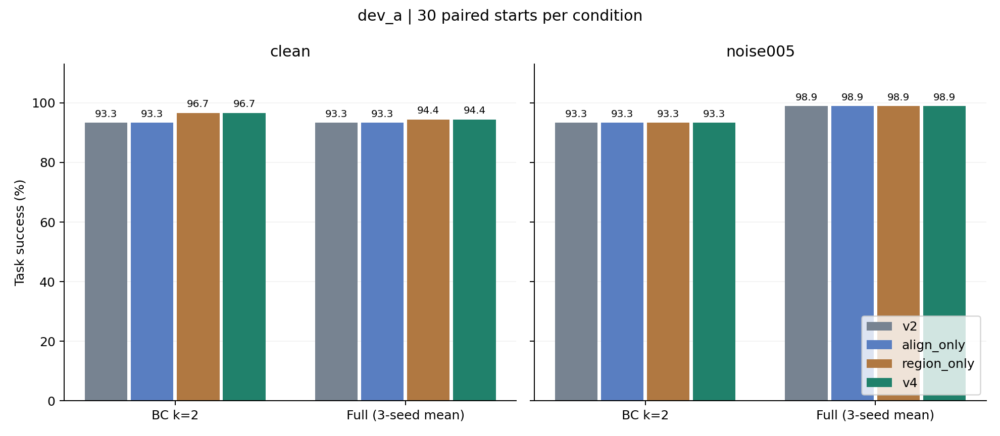
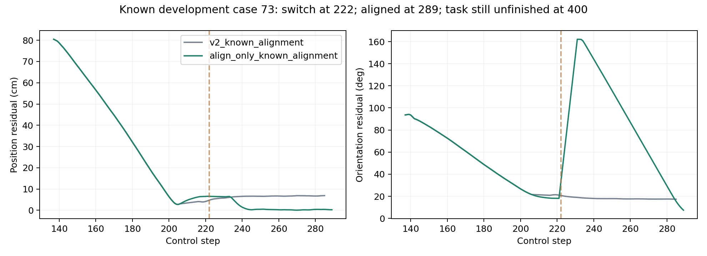

# v4 本轮评估：局部改善，尚不替换 v2

两项改动已在独立目录实现，完成了分别测试、组合消融、开发集对照和核验。**区域约束角落抓取有局部收益；方向切换能够解除已知对齐卡住，但尚未增加最终任务成功数。** 最佳候选为 231/240，低于事先登记的 232/240 推进门槛。因此本轮没有选出确认候选，没有生成或运行新独立确认起点，也没有把 v4 切换为正式版本。没有撰写论文。

## 实际执行范围

- 两轮小测试：100 + 100 = **200 回合**。第一轮及其源码快照完整保留。
- 三个候选开发集：3 × 240 = **720 个新回合**。v2 的 240 回合对照复用原封保存、哈希核验通过的历史同协议结果，不计入本轮新执行数。
- 本轮合计 **920 个新执行回合**。每轮开发使用同样的 30 个起点、两种噪声、BC k=2 和 Full 的三个固定训练种子。
- 60 个新原生起点、16 个新几何压力起点的种子和生成程序已经预先准备，但**未执行**。独立确认不适用本轮结果，不能借用 v3 旧确认成绩。

## 最终开发结果

| 方案 | BC 干净 /30 | BC 噪声 /30 | Full 干净 /90 | Full 噪声 /90 | 合计 /240 | 救回 / 新增失败 |
|---|---:|---:|---:|---:|---:|---:|
| v2 | 28 | 28 | 84 | 89 | 229 | 基线 |
| A：仅方向切换 | 28 | 28 | 84 | 89 | 229 | 0 / 0 |
| B：仅区域约束角落抓取 | 29 | 28 | 85 | 89 | 231 | 2 / 0 |
| AB：组合 v4 | 29 | 28 | 85 | 89 | 231 | 2 / 0 |

**两次救回都是 `demo_188`：一次为 BC 干净条件，一次为 Full s17 干净条件。只涉及一个开发起点。** 不能把三个训练种子、两种噪声或两次救回当作新的独立环境样本。组合相对区域单项没有额外任务成功收益。

事先门槛另含：最多 2 次退步、BC 两种条件各至少 28/30、Full 干净至少 84/90、噪声至少 89/90。三种候选仅总成功数一项未通过；门槛未在看完结果后下调。详见 [预登记](study_plan.json) 与 [门槛判定](promotion_dev_a.json)。

按起点配对 bootstrap，Full 三种子先在每个起点内求均值。组合相对 v2 的干净条件差值：BC +3.33 个百分点，95% 区间 [0,10]；Full +1.11 个百分点，[0,3.33]；噪声条件均为 0。这里只描述已知开发集，不能作独立泛化证据。零变化造成的退化区间也不意味着严格等价。

## 两项机制究竟做了什么

**A：保留原方向，有证据表明停滞才换方向。** 默认仍用 v2 最近的等价朝向。高位对齐的位姿残差长期不改善，且物体直立、静止、位于合法箱格时，先回到安全高度，再将目标 yaw 翻转 π。仍然最多两次尝试，真实 D=2 队列不清空，总预算 400 步。第一次仍在前进的对齐可有界延长，高位替代方向使用有界旋转步长；没有改变正常策略、下降和搬运控制。

已知噪声开发案例 `demo_73`：第 222 步观察到停滞并切换，第 289 步完成对齐，第 333 步验证重新抓持，第 353 步开始搬运。但 400 步结束仍在搬运，任务仍计失败。v2 在该例耗尽对齐尝试。**这是中间机制改善，不是新增任务成功。**

**B：确认“在格内且能容纳夹爪”后才做角落调整。** 有符号边界与物体足迹检查排除隔板、格外、墙顶、空中及侧倒物体；合法直立角落才尝试有限内移、夹爪开度和满足近似两指投影间隙的角度。仍选择最近的等价方向，没有沿用 v3 的全局固定朝向或侧倒手掌倾斜。直立高位接近保留 v2 的抬升约束；几何筛选是近似，不承诺任意构型都无碰撞。

四个已知困难几何用例：v2/A 为 0/4，B/AB 为 3/4，其中两个目标角落均通过。对这两个角落进行完整物理回放：

| 已知起点 | v2 下降阶段墙体接触采样次数 | B 接触采样次数 | v2 / B 成功 |
|---|---:|---:|---|
| demo_6100002 | 116 | 1 | 否 / 是 |
| demo_6100003 | 115 | 0 | 否 / 是 |

接触按 20 Hz 控制时刻采样，不是每个物理子步；第一例仍有一次短暂接触，因此不能说完全无碰撞。关节限位和接触只用于事后诊断，未进入控制决策。

v3 的三个已知退步案例在本轮四组中均通过，说明这组回归用例得到保护；不能由三个案例推出任意状态都无退步。已知用例与原自然抓取、失抓、持物停滞、旧几何测试一起保存在 [小测试验收](pilot_acceptance.json)。

## 仍然未完成的 9 次执行

| 类别 | 次数 | 具体结果 |
|---|---:|---|
| 侧倒后下降抓取未成功 | 5 | Full 干净条件下 demo_97（三种子）、demo_128（s23）、demo_188（s23）；最终耗尽尝试，仍存在近箱壁/隔板的低位接近问题 |
| 搬运或放置预算不足 | 3 | BC 噪声 demo_73 在 CARRY；BC 噪声和 Full s41 噪声 demo_124 在 PLACE |
| 物体已掉出桌面恢复区域 | 1 | BC 干净 demo_124，终点高度约 0.025 m，桌面为约 0.8 m |

上述 9 次执行来自 **5 个开发起点**。五个下降失败在 v2 中也存在，本轮未改变侧倒分支；当前日志与旧诊断一致，但不将仅有阶段标签的案例一律宣称为已重新测量到碰撞。

`demo_124` 两个 PLACE 失败在第 384 步才进入放置，400 步时物体高度约 0.909 m，尚未达到既有释放条件。不能把“接近完成”算成功。详见 [逐例失败清单](diagnosis_dev_a.json)。

## 下一步建议

1. 保留 B 为值得继续验证的候选；A 保留为可开关的机制模块。当前 AB 没有超出 B 的任务收益，不应为组合而组合。
2. 下一轮先单独改进**剩余步数感知的恢复时机**：为接近、抓持验证、搬运和放置预留时间，减少第一次无效下降占用 70 步的情况。先检查已知 73/124 案例是否能在原 400 步内完成，同时验证普通成功案例不退步。不通过延长总回合时间制造不公平提升。
3. 侧倒物体另做一个最小几何分支：明确其合法箱格、轴向范围和手掌/两指间隙；间隙不足时采用有限回退，不直接复用 v3 的固定倾斜。针对 97/128/188 分别做消融。
4. 新一轮另行预登记推进条件，开发通过后再冻结与生成未查看的新起点。不得以本轮差一个成功为理由事后降低本轮门槛。

## 整体项目判断

项目已有世界模型候选评分、强 BC k=2 对照、三训练种子、公平消融、共享恢复、失败诊断及可回放机器人演示，具备本科毕业设计的工程与实验基础。本轮又补齐了针对 v3 退步的保护测试和 A/B/AB 消融，实验结论可以复查。

**当前不能把 v4 表述为已经全面解决对齐、角落及恢复问题的最终算法，也不能把共享控制器的收益解释为世界模型预测能力提升。** v4 没有独立确认；本轮亦未重新评估或改变既有世界模型权重。该项目适合作为有边界、包含失败分析的本科毕业设计基础；由于没有学校正式任务书或评分标准，不能据此承诺毕业审核通过。先继续改进实验即可，本轮没有写论文。

## 验证与保留

- **2735 个已有项目文件**的 SHA-256 内容不变，覆盖 v1、v2、v3、项目内权重及历史结果；保护清单不包含虚拟环境、IDE 和缓存目录。
- 两轮小测试和开发集共 **920 回合、168058 个控制步骤**完成控制器、事件、D2 队列、噪声与记录一致性检查；第一轮使用其原始源码快照核验。
- **20 条物理轨迹重放**与日志观测逐步完全一致：小测试抽样 8、开发集抽样 6、机制诊断 6。这些是对既有回合的重放，不能再算新独立实验。
- 所有旧模型、权重、结果和演示入口保留。v4 文件只在本目录；没有生成 `freeze_before_states.json`、`confirmation_starts.hdf5` 或独立确认结果。
- 数值原始汇总：[summary.json](analysis_dev_a/summary.json)；开发验证：[validation_dev_a.json](validation_dev_a.json)；最终保护收据：[delivery_validation.json](delivery_validation.json)；运行入口：[README.md](README.md)。
