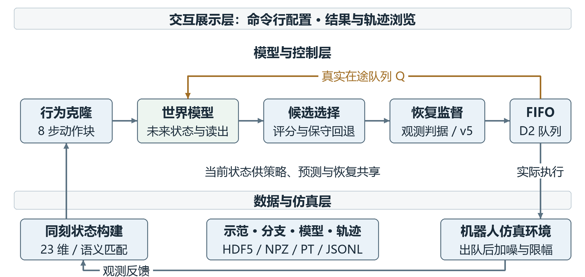
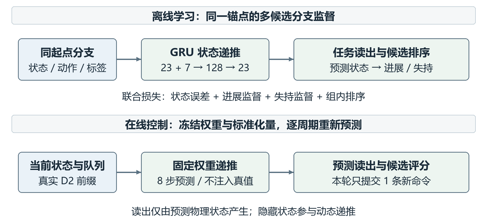

# 基于世界模型的机器人抓取搬运系统设计与实现

# 第4章 系统设计

本章围绕机器人罐体抓取搬运任务，设计由行为克隆（BC）策略、世界模型、延迟动作队列和失败恢复控制组成的闭环系统。世界模型学习当前状态与动作后果之间的关系，对候选动作的未来状态、任务进展和失持风险进行预测，为动作选择提供依据。系统基于robosuite和MuJoCo构建Panda机器人仿真环境[1-2]，采用低维状态输入完成抓取、搬运和放置。本章依次说明系统架构、功能模块、数据组织和模块接口。

## 4.1 系统架构设计

### 4.1.1 总体架构

系统分为交互展示层、模型与控制层、数据与仿真层。交互展示层提供实验启动和结果浏览入口；模型与控制层承担动作生成、未来预测、候选评价及恢复控制；数据与仿真层保存示范、模型和执行记录，并推进机器人与物体的物理状态。各层通过文件配置、内存数组和Python函数传递数据，整体结构如图4-1所示。

图4-1 世界模型抓取搬运系统总体架构

交互展示层包括命令行运行入口和本地静态结果页面。实验人员指定策略、世界模型、扰动和恢复配置后启动任务，通过结果页面查看成功数、对照图和原始证据。页面读取已生成的结果文件，控制决策在Python评估进程内完成。

模型与控制层以世界模型动作评估为核心。行为克隆策略先生成动作块，世界模型结合当前状态和真实在途命令预测不同候选的后果，候选选择器输出建议动作。恢复监督器根据观测历史判断是否接管，随后把最终命令提交给动作队列。世界模型筛选与恢复控制分别承担动作比较和异常处置，具有独立开关。

数据与仿真层采用HDF5保存示范和起点，NPZ保存同起点分支，PT保存模型检查点，JSON及JSONL保存配置和运行结果。仿真环境按20Hz执行七维动作，并向模型与控制层返回新观测。位置单位为米，姿态使用xyzw四元数，归一化动作范围为$[-1,1]$。

### 4.1.2 离线训练与在线控制

离线阶段从示范构造状态与动作块训练行为克隆策略，再在真实延迟队列下采集同起点候选分支，训练世界模型的状态预测、任务读出和组内排序。模型部署时固定权重，复用训练阶段保存的标准化参数，不在任务执行过程中更新网络。

在线阶段每次接收观测后重新生成和评价候选，仅提交一条新命令。当前物理执行来自队列最旧项，环境推进后再次观测。该设计将有限时域预测嵌入逐步闭环，避免把整段预测动作直接当作实际执行结果。未来真实状态与奖励只在离线监督或事后评价中使用，不作为在线筛选的真值输入。

## 4.2 系统功能设计

### 4.2.1 状态构建与预处理模块

状态构建模块把仿真器观测整理为23维向量，字段如表4-1所示。相对位姿描述物体与末端之间的抓取关系，绝对位姿描述物体所在区域和运输目标。两类信息同时存在时，需要保持坐标系、四元数顺序和时间对应关系一致。

表4-1 状态向量字段设计

| 索引 | 维数 | 字段 | 含义 |
|---|---|---|---|
| 0:3 | 3 | 末端位置 | 世界坐标系位置 |
| 3:7 | 4 | 末端姿态 | 世界姿态四元数xyzw |
| 7:9 | 2 | 夹爪关节位置 | 两个夹指的关节量 |
| 9:12 | 3 | 物体相对位置 | 在末端坐标系中表达 |
| 12:16 | 4 | 物体相对姿态 | 相对末端的四元数 |
| 16:19 | 3 | 物体位置 | 世界坐标系位置 |
| 19:23 | 4 | 物体姿态 | 世界姿态四元数xyzw |

系统保留legacy和canonical两种观测语义。legacy兼容旧数据及冻结模型；canonical从同一帧绝对位姿重算相对字段，避免缓存顺序导致相对与绝对观测错位。设末端、物体世界位姿为$(p_e,q_e)$和$(p_o,q_o)$，则：

$$
p_{rel}=R(q_e)^\top(p_o-p_e),\qquad q_{rel}=q_e^{-1}\otimes q_o.
$$

其中R为四元数对应的旋转矩阵，⊗为四元数乘法。canonical检查输入维度、有限值和两个绝对四元数的有效范数，并规范相对四元数符号；legacy在线路径保留历史拼接行为。本文将联合学习状态预测、任务读出与排序的完整世界模型记为Full；当前正式Full仍使用legacy，不能只因维数相同就切换到canonical。

模型分别使用自身训练数据的均值和尺度标准化状态，尺度下界为0.02，并随检查点保存。开发集和在线观测复用这些统计量。新训练读取器只允许train和dev，主示范共200段，划分为140段训练、30段开发及30段封存测试；窗口不会跨示范边界拼接。

### 4.2.2 行为克隆动作生成模块

行为克隆模块从当前23维状态生成8步七维动作块，为世界模型提供有限候选。网络采用三个宽度512的全连接隐层和5分量混合密度输出头，使用负对数似然训练。混合密度网络能够描述连续输出的多种模式[3]，减少仅回归平均动作带来的模式混合。

每个高斯分量覆盖完整动作块，输出混合权重、均值和对角标准差。均值经过tanh限于$[-1,1]$，标准差经softplus后限制在[0.02,1]。部署时选择混合权重最大的分量均值，不随机采样。动作前三维为平移控制量，中间三维为旋转控制量，最后一维为夹爪控制量。

输入为窗口起点状态，监督目标为该点之后8条示范动作。训练采用Adam，学习率0.0003、批量256、15,000次更新，保存开发集最优和固定末次检查点。检查点使用规则在闭环评价前确定；BC本身不判断恢复状态，也不依赖世界模型反向更新权重。

### 4.2.3 世界模型预测与学习模块

世界模型以状态和动作序列为条件，预测动作造成的短期物理变化。这一设计采用学习环境动态为控制提供信息的思路[4]，具体实现为显式状态空间中的小型循环网络。输入状态为23维，动作维数为7，预测时域为8步，隐藏状态宽度为128。

记标准化状态为$z_j$，隐藏状态为$h_j$。初始隐藏状态由当前状态经过线性层和tanh得到，随后按动作逐步递推：

$$
h_{j+1}=\operatorname{GRUCell}([z_j,u_j],h_j),\qquad z_{j+1}=z_j+0.1f_\Delta(h_{j+1}).
$$

GRU为门控循环单元，输入维数为23+7；残差网络$f_\Delta$采用128→128→23结构。系数0.1用于缩放状态残差，不代表控制周期。预测状态经尺度和均值变换返回物理量，并继续作为下一步输入，不在中间注入未来真值。

图4-2 世界模型的离线学习与在线读出

任务读出头采用23→128→2结构，分别输出进展与失持logits。正式Full使用future_only配置，读出只经过预测物理状态，不直接拼接隐藏状态；隐藏状态仍参与动态预测。网络总可训练参数为87,321。模型不对预测姿态施加刚体投影，因此未来状态可能偏离严格几何关系，输入端的canonical处理不能自动约束预测结果。

训练数据按同一物理锚点组织多个动作分支。采集时先重放真实执行历史恢复锚点及控制器状态，再保留相同在途队列展开四个候选。正式数据包含160组训练分支和64组开发分支，每组4个候选、8步未来，父轨迹在训练与开发之间隔离。各候选前两步应具有相同物理结果，用于核对公共延迟前缀。

进展标签在成功时取1，否则取阶段奖励最大值，属于连续软标签。初始抓取标记取决于锚点抓取阶段奖励是否大于0.3；仅当该标记为真、后续抓取奖励低于0.3且未成功时，失持标签取1，否则取0。该定义不同于恢复器的观测抓持判据。损失包括归一化状态误差、两类标签交叉熵与组内排序：

$$
\mathcal L=\mathcal L_{pred}+\mathcal L_p+0.5\mathcal L_r+0.2\mathcal L_{rank}.
$$

其中$\mathcal L_{pred}$为标准化状态残差平方的均值，$\mathcal L_p$和$\mathcal L_r$为带logits的二元交叉熵；排序项只比较同组真值评分差大于0.025的候选对，温度为0.1。组内排序用于区分动作相对优劣，状态预测用于约束动作后果的物理表示。

系统还保留Plain、DirectScore和prediction_only作为方法对照。prediction_only只训练状态预测、按开发状态误差选点，部署绕过未训练任务头并使用物理代价。正式恢复实验入口只装载冻结Full，不能把通用预测对照的评分规则混入正式配置。

表4-2 策略与世界模型主要参数

| 项目 | 行为克隆策略 | 正式Full世界模型 |
|---|---|---|
| 状态输入 | 23维 | 23维 |
| 动作时域 | 输出8步 | 预测8步 |
| 主体结构 | 三层512宽度MLP | 128宽度GRUCell |
| 输出 | 5分量动作块分布 | 未来状态及两类读出 |
| 部署方式 | 确定性选分量 | 固定权重候选评价 |
| 训练目标 | 动作块负对数似然 | 状态 标签 排序联合损失 |

### 4.2.4 候选动作评估与延迟执行模块

候选评估模块从BC动作块取索引0、1、2、3的四条命令。对每条候选命令$c_k$，模型输入序列由当前真实队列$Q_t=[q_t^0,q_t^1]$及重复候选组成：

$$
U_k=[q_t^0,q_t^1,c_k,c_k,c_k,c_k,c_k,c_k].
$$

前两步是已经提交且不能被本轮候选替换的动作，后六步反映候选持续执行的短时假设。该序列用于比较候选，在线实际只提交一条命令，下一周期重新预测。模型不预先知道之后的执行噪声，也不把预测轨迹当作真实轨迹保存。

图4-3 含真实队列前缀的候选动作评价

预测logits经sigmoid得到进展$p_j$和失持读出$r_j$，候选分数定义为：

$$
S_k=p_{k,H}+\frac{0.5}{H}\sum_{j=1}^{H}p_{k,j}-0.5\max_j r_{k,j}.
$$

评分同时考虑末步进展、平均进展与峰值失持。先取最高分候选；如果它不是默认索引2，且相对索引2的分数提升小于0.02，则回退到索引2。关闭世界模型时也使用索引2，使对照保留相同BC及延迟补偿基线。读出是训练任务下的排序信号，不直接等同于经过校准的成功概率。

D2执行队列初始为两条零动作。每步先把最终提交命令$u_t$加入尾部，再从头部取出动作，关系为：

$$
a_t=Q_t[0],\qquad Q_{t+1}=[Q_t[1],u_t].
$$

因此$u_t$在两个周期之后执行。出队动作的前三维按配置加入标准差0或0.05的高斯噪声，再限幅到$[-1,1]$，最后送入环境。20Hz下两周期名义延迟为0.10s；噪声0.05是归一化动作单位，不是位置测量误差。

### 4.2.5 失败恢复监督模块

恢复监督器位于候选建议与队列提交之间，只接收当前状态、建议动作、上一次实际执行动作及固定任务几何。它不接收世界模型评分、未来状态真值或环境成功标志。正常情况下透传候选建议，出现失持、长停滞或预算压力下的早期停滞时执行恢复。

可观测抓持要求夹口处于0.025至0.067m、末端与物体距离小于0.09m、最近五帧世界系相对位置变化小于0.012m、物体抬升超过参考高度0.02m，并结合已执行闭爪命令或抓持锁存状态。连续丢失五帧且不属于主动释放时判为失持。五帧窗口用于抓持判断，不是任务成功判据。

恢复流程包括回撤、对齐、下降、闭爪、试抬确认、抬升、搬运、放置、释放和退出。各阶段设置位置阈值、最小驻留和超时；例如CLOSE等待18步，TEST_LIFT在试抬后确认抓持，RELEASE等待16步。流程如图4-4所示。

图4-4 抓取失败后的有界恢复流程

单回合最多两次恢复尝试，控制预算为400步；额度用尽或物体越出恢复区域后进入EXHAUSTED，停止恢复覆盖并透传策略建议。恢复器保留针对固定容器与夹爪的局部几何余量检查，但不代表机械臂全链条碰撞保证。现有队列预算扩展仍作为未采用候选保存，本章以冻结v5作为恢复实现。

### 4.2.6 结果记录与展示模块

记录模块在每次控制时保存状态、BC块、候选评分、恢复诊断、队列和实际动作。基准在首次满足环境成功判据或400步时结束；环境成功只由评估器读取。成功回合额外执行20步稳定观察，单独存储，不增加基准控制步数或独立起点数。

展示模块读取完成的结果与统计文件，提供条件对照、轨迹证据和失败案例入口。主确认轨迹保存scores与动作链，未保存世界模型全部预测状态；如需分析预测序列，应使用具有该字段的通用评估入口或另行登记记录方案。页面展示不参与实时控制。

## 4.3 数据结构与存储设计

### 4.3.1 数据实体及关联

系统围绕示范轨迹、候选分支、模型检查点、实验作业、回合结果和控制记录组织数据。示范轨迹以demo标识；分支保留parent及锚点，连接其来源轨迹；作业指定模型、起点和控制配置；回合以作业和demo定位；逐步记录由demo与step定位。关系如图4-5所示。

图4-5 研究数据实体及逻辑关联

这些关系由文件元数据和程序校验维护，不依赖关系数据库。示范数据一般采用HDF5分组组织[5]，本项目沿用该方式保存连续数组；分支训练使用NPZ便于按候选组装载；模型权重及其配置共同写入PT。JSON负责结构化配置和汇总，JSONL按行保存较大的控制轨迹。

表4-3 数据实体与存储方式

| 实体 | 存储形式 | 主要内容 | 关联标识 |
|---|---|---|---|
| 示范与起点 | HDF5 | 观测 动作 物理状态 XML | demo |
| 候选分支 | NPZ | 同起点候选及未来标签 | parent point |
| 模型检查点 | PT | 网络参数 配置 标准化量 | 文件路径与SHA |
| 实验作业 | JSON | 方法 起点 延迟 噪声 | id |
| 回合结果 | JSON | 成功 步数 恢复与计时 | job demo |
| 控制轨迹 | JSONL | 状态 动作 队列 诊断 | demo step |

### 4.3.2 候选分支与检查点结构

分支数据必须保留同起点的候选组，训练时先抽取组，再把组内候选展开为批量序列。设组数为N，候选数为K=4，时域H=8，主要数组设计如表4-4所示。将同一候选组拆散后随机划分训练与开发会引入共享起点信息，因此数据划分以parent为单位。

表4-4 世界模型分支数据字段

| 字段 | 形状或类型 | 含义 |
|---|---|---|
| x | N×23 | 锚点当前状态 |
| a | N×K×H×7 | 真实出队执行动作序列 |
| y | N×K×H×23 | 分支未来物理状态 |
| labels | N×K×H×2 | 进展与失持监督 |
| parent、point | 每组标识 | 父轨迹与锚点来源 |
| observation_semantics | 标量字符串 | legacy或canonical |

新canonical分支要求显式语义元数据，并核对几何一致性；历史缺省声明按legacy处理。parent在规范中为必需来源字段：现有入口在元数据存在时检查父轨迹隔离，缺少该字段时无法完成同等隔离检查，不应把缺失元数据的数据直接用于正式比较。

检查点的state_dict保存网络及标准化buffer，config保存dim、horizon、width、method、seed和观测语义等。加载时同时检查这些配置与运行任务，避免维度正确但语义、预测时域或读出方式错误。BC检查点另外保存mixtures和architecture，正式Full还要求future_only为真。

### 4.3.3 作业与执行记录结构

作业由id、method、seed、controller、semantics、noise、demos、steps和delay等字段组成。正式恢复作业限定method为bc或full，controller为none、v5或queue_budget，steps为400、delay为2。Full使用三个已登记的固定模型种子，起点列表必须非空且无重复。

result.json包含作业副本、运行状态及回合records。每个回合记录成功与终止步数、干预步数、尝试次数、恢复事件及计时。trace.jsonl按表4-5记录完整控制链，使候选建议、恢复覆盖和延迟执行可以逐项区分。

表4-5 逐步控制记录字段

| 字段组 | 主要字段 | 记录目的 |
|---|---|---|
| 身份 | demo、step | 定位回合与控制周期 |
| 决策输入 | state_before、base_chunk | 保存观测和BC建议 |
| 候选评估 | selected、scores、proposal | 还原候选比较与回退 |
| 恢复输出 | recovery、submitted_action | 定位动作覆盖与转换 |
| 延迟执行 | queue_before、executed_action | 核对FIFO与实际动作 |
| 执行后 | state_after、success_after | 检查状态连续性与终止 |
| 计算耗时 | compute_ms | 观察模型与控制计算量 |

加噪前的出队命令另存executed_action_before_noise，以便重建噪声和限幅。compute_ms包括观测打包、BC、可选世界模型和恢复计算，不包括物理推进与文件写入。输出目录拒绝复用，阶段状态区分running、complete和failed；只有登记条件全部完成的阶段才进入正式统计。

## 4.4 模块接口与协同流程设计

### 4.4.1 模块接口

系统控制接口采用同一Python进程内的函数调用，传递NumPy数组或PyTorch张量。接口设计关注形状、单位、语义版本和返回值，而非为本地计算增加网络请求。主要接口如表4-6所示。

表4-6 主要模块接口

| 接口 | 输入 | 输出 | 约束 |
|---|---|---|---|
| pack_observation | 原始观测与语义 | 23维状态 | 语义与模型匹配 |
| ChunkPolicy.best | B×23状态 | B×8×7动作块 | 复用训练标准化量 |
| WorldModel.forward | 状态与动作序列 | 未来状态与标签 | H=8 动作维数7 |
| pending_sequences | 2×7队列与候选 | K×8×7序列 | 使用真实在途命令 |
| propose | 模型 状态 BC块 队列 | 建议 索引 评分 | 保留0.02回退阈值 |
| supervisor.choose | 状态 建议 上次实际动作 | 提交动作与诊断 | 不接收评分或成功真值 |

状态输入维数、动作时域和控制比例在启动时核对。当前OSC_POSE采用world参考系增量控制，平移每轴输出上限0.05m、旋转每轴上限0.5rad，接口思想参见官方控制器文档[6]，具体数值以本项目环境配置为准。归一化命令比例不能直接解释为接触状态下必然实现的末端位移。

### 4.4.2 闭环调用时序

闭环先构建状态并调用BC，再依据真实队列评价候选；恢复监督器可覆盖建议，最终提交动作才进入队列。出队后加噪并限幅，环境执行并返回新观测。调用顺序如图4-6所示。

图4-6 单个控制周期的调用时序

恢复器中的previous_action必须是上一周期已经实际执行、经过加噪和限幅的动作，而不是上一条新提交命令。对预算扩展，评估器在choose前提供当前队列副本。环境成功检查位于执行之后，仅决定记录与回合终止；其结果不会进入恢复器触发条件。

### 4.4.3 配置与异常处理

运行前检查模型配置、观测语义、起点存在性、预算与队列长度。正式Full不接受canonical观测，不接受未登记模型种子；配置中的控制器延迟和上限必须与实际FIFO及循环预算一致。模型方法不支持所选读出时应拒绝启动，不能以未训练标签头填补缺失评分。

运行中发生异常时保留已有轨迹并尽力写入failed状态，环境在结束时释放。普通结果写入并非统一原子事务；遇到记录故障需保留原尝试，在新目录用相同冻结输入重跑并比较重合前缀。来源哈希和作业快照用于检测漂移，重复回放或重跑不增加独立样本数。

## 4.5 本章小结

本章完成基于世界模型的机器人抓取搬运系统详细设计。系统以行为克隆提供候选，通过动作条件世界模型预测未来状态并评价动作后果，结合真实D2队列实现逐步闭环，由独立恢复监督器处理失持和停滞。数据设计明确示范、分支、检查点和运行记录的关联，模块接口限定输入语义及调用顺序，为后续系统实现与实验测试提供依据。当前设计面向低维特权状态仿真，世界模型与恢复模块的性能作用以各自的同批对照结果为依据。

# 参考文献

[1] ZHU Y, WONG J, MANDLEKAR A, et al. robosuite: A Modular Simulation Framework and Benchmark for Robot Learning[EB/OL]. arXiv:2009.12293v1, 2020[2026-10-22]. https://arxiv.org/abs/2009.12293v1.

[2] TODOROV E, EREZ T, TASSA Y. MuJoCo: A physics engine for model-based control[C]//2012 IEEE/RSJ International Conference on Intelligent Robots and Systems. IEEE, 2012. DOI: 10.1109/IROS.2012.6386109.

[3] BISHOP C M. Mixture Density Networks[R]. Birmingham: Aston University, 1994. NCRG/94/004.

[4] HA D, SCHMIDHUBER J. World Models[EB/OL]. arXiv:1803.10122, 2018[2026-10-22]. https://arxiv.org/abs/1803.10122.

[5] MANDLEKAR A, XU D, WONG J, et al. What Matters in Learning from Offline Human Demonstrations for Robot Manipulation[C]//Proceedings of the 5th Conference on Robot Learning. PMLR, 2022, 164: 1678-1690.

[6] robosuite. Controllers[EB/OL]. [2026-10-22]. https://robosuite.ai/docs/modules/controllers.html.
